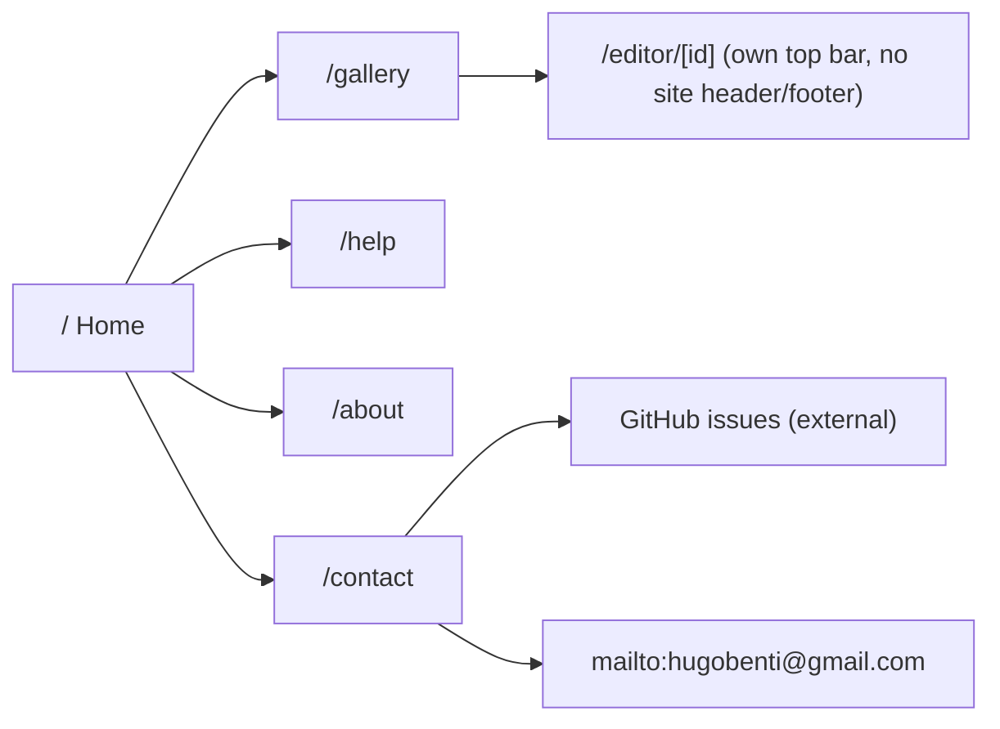

# PixelHB presentation: site shell, pages and copy

Status: draft for Hugo's approval (Oct 22, 2026).
Scope: everything around the editor: the home page, the gallery, the new site pages, the header, the footer, the phone menu and the copy. The editor (`/editor/[id]`) is out of scope; it gets its own pass later.

## Why

PixelHB is about to launch, and outside the editor it doesn't look like a product yet. A review of the gallery at 390 × 844 and 1440 × 900, in both themes (`feat/brand-logo`, Oct 22), found:

- Nothing explains what PixelHB is. The only sentence is "Local artworks stored in your browser (IndexedDB).", which is developer jargon.
- There is no navigation. The header is a logo plus a row of three unrelated controls (theme switch, Import JSON, New artwork) with three different looks.
- The gallery has no heading and no count. Cards show only a title, the `⋯` button sits alone on its own row, and the thumbnail is a box inside a box.
- The empty state is one sentence with no action.
- Errors ("Rename failed.") don't say what to do.
- The light theme's accent is ultramarine while the logo's "HB" is burnt amber, so the two themes read as two brands.
- `/` only redirects to `/gallery`. There is no About, Help or Contact page, and the 404 is Next.js's default black page.
- Nothing warns that the artworks live only in this browser.
- **The `⋯` card menu fails on phones** (Hugo, on a real phone). In emulation it always opens downward: on the last card its bottom lands at 921px on an 844px screen, and it overlaps the next card with nothing separating the two.

Success: someone who has never heard of PixelHB lands on the site from a phone or a desktop, understands in one screen what it is and that their work stays on their device, starts drawing in one tap, and finds help, the author and a way to send feedback without hunting.

## Goals

1. A home page at `/` that presents the product and leads to the gallery.
2. One shared site header and footer on every page except the editor, with a real menu on phones.
3. A gallery with a heading, useful cards, a real empty state and a data-safety note.
4. New pages: About, Help, Feedback & contact, plus a branded 404 and error page.
5. Copy that is plain, consistent and free of jargon, in one voice.
6. A light-theme accent that matches the brand.
7. A card menu that works on real phones.

## Non-goals

- The editor screen: layout, tools, panels and its copy (later pass). The editor only inherits the light-accent change, as the color tokens are global.
- Accounts, cloud sync, analytics, a newsletter, a blog, a changelog.
- A showcase of artwork. No such artwork exists (PRODUCT.md "Evidence on Hand").

## Anti-goals (failures even if it ships)

- Fabricated proof: testimonials, user counts, "loved by artists", made-up sample galleries.
- Copy that explains the pencil/HB joke or uses the word "pencil" (brand.md).
- A marketing page that slows down a returning user: from `/`, the gallery is always one click or tap away.
- Anything that changes users' stored data (IndexedDB name, `localStorage` keys).
- Hype: "revolutionary", "powerful", "seamless", exclamation marks.

## Constraints

- `AGENTS.md` rules: presentation-only `.tsx`, `X.style.ts` / `X.type.ts` / `useX.ts` / `X.data.ts`, all copy in `src/content`, token-only styling, no UI kit, feature boundaries, ≤ ~20 files per PR, a branch and PR per stage, never commit to `main`.
- `DESIGN.md` color and type tokens; `brand.md` logo usage (whole-number scales, clear space, minimum sizes).
- WCAG 2.2 AA for every token pair (`tokenContrast.test.ts`), visible focus, 44px targets on coarse pointers, reduced motion honored.
- Depends on the unmerged `feat/brand-icons` and `feat/brand-logo` branches (`BrandLogo`, icons, manifest, `--color-brand-hb`). They land first.
- `brand.md` lists "No … marketing site" as a non-goal. Hugo has asked for a home page; this design changes that line to: "No marketing site beyond the home page; no mascot or illustration set."

## Decisions Hugo made (Oct 22)

- `/` becomes a home page (this document proposes it; Hugo approves the proposal).
- Pages at launch: About, Help, Feedback & contact. Contact uses `hugobenti@gmail.com` and links to the GitHub repo `https://github.com/hugobenti/pixelHB` (public).
- The light-theme accent changes to match the brand.
- A footer is added.
- The theme switch moves out of the action row; the author's name goes in the footer.

## Sitemap



Every page except the editor has the site header and footer (a shared route-group layout fits). Unknown URLs get the branded 404 with the same shell.

## Site header

- **Desktop (≥ 640px):** logo (horizontal lockup, links to `/`), then text links **Gallery · Help · About**, then on the right a theme icon button (sun/moon; its accessible name says what it switches to) and the page's primary action: **Start drawing** on the home and site pages, **New artwork** on the gallery. One accent button per view.
- **Phone:** logo, then the primary action, then a ☰ menu button. ☰ opens a bottom sheet with Gallery, Help, About, Feedback & contact, and the Light / Dark switch. The sheet uses the existing `Modal` phone-sheet mode (focus trap, Escape, backdrop dismiss, safe-area padding). On the gallery the phone primary action is a compact "New" button.
- The current page's link is marked (`aria-current="page"`, `fg` text plus a 2px underline in `line-strong`, never the accent).
- The editor keeps its own top bar and gets no site header (brand.md).

## Footer

Three lines, `text-sm muted`, on `bg` with a `line` top border:

1. The pencil mark (brand.md "Pencil alone", 2×) and the line "Pixel-art editor for the browser."
2. Links: Gallery · Help · About · Feedback & contact · GitHub (external, opens in the same tab, labeled "GitHub").
3. "Made by Hugo Bentivegna · © 2026".

On phones the links wrap into two rows with 44px targets.

## Home page (`/`)

```svg
<svg viewBox="0 0 860 620" xmlns="http://www.w3.org/2000/svg" font-family="sans-serif" font-size="13">
  <rect x="0" y="0" width="560" height="620" rx="10" fill="none" stroke="var(--border)"/>
  <text x="16" y="28" fill="currentColor" font-weight="bold">▰▰▰▸ PixelHB</text>
  <text x="200" y="28" fill="var(--muted)">Gallery    Help    About</text>
  <text x="430" y="28" fill="var(--muted)">☾</text>
  <rect x="450" y="12" width="96" height="26" rx="6" fill="var(--accent)"/><text x="461" y="30" fill="var(--surface)">Start drawing</text>
  <line x1="0" y1="48" x2="560" y2="48" stroke="var(--border)"/>
  <text x="40" y="110" fill="currentColor" font-size="30" font-weight="bold">Pixel art, right in</text>
  <text x="40" y="146" fill="currentColor" font-size="30" font-weight="bold">your browser.</text>
  <text x="40" y="178" fill="var(--muted)" font-size="14">Draw sprites, icons and tiles with layers, mirror guides</text>
  <text x="40" y="198" fill="var(--muted)" font-size="14">and a reference image. No account, no install.</text>
  <rect x="40" y="216" width="110" height="34" rx="6" fill="var(--accent)"/><text x="54" y="238" fill="var(--surface)">Start drawing</text>
  <rect x="160" y="216" width="110" height="34" rx="6" fill="none" stroke="var(--border)"/><text x="176" y="238" fill="currentColor">Read the guide</text>
  <rect x="300" y="72" width="230" height="170" rx="8" fill="none" stroke="var(--border)" stroke-dasharray="2 4"/>
  <rect x="330" y="146" width="150" height="22" fill="var(--c4)"/><rect x="480" y="150" width="14" height="14" fill="var(--c2)"/><rect x="504" y="150" width="8" height="8" fill="currentColor"/>
  <text x="318" y="230" fill="var(--muted)" font-size="11">brand pencil, large, on a faint pixel grid</text>
  <rect x="40" y="280" width="150" height="110" rx="8" fill="none" stroke="var(--border)"/>
  <text x="52" y="304" fill="currentColor" font-weight="bold">Open it and draw</text><text x="52" y="324" fill="var(--muted)" font-size="11">No sign-up, no download.</text>
  <rect x="205" y="280" width="150" height="110" rx="8" fill="none" stroke="var(--border)"/>
  <text x="217" y="304" fill="currentColor" font-weight="bold">Stays on your device</text><text x="217" y="324" fill="var(--muted)" font-size="11">Saved in this browser.</text>
  <rect x="370" y="280" width="150" height="110" rx="8" fill="none" stroke="var(--border)"/>
  <text x="382" y="304" fill="currentColor" font-weight="bold">Ready for your game</text><text x="382" y="324" fill="var(--muted)" font-size="11">Crisp PNG export.</text>
  <text x="40" y="430" fill="currentColor" font-weight="bold" font-size="16">How it works</text>
  <text x="40" y="456" fill="var(--muted)">1  Create a canvas     2  Draw     3  Export</text>
  <rect x="40" y="476" width="480" height="40" rx="8" fill="var(--surface)" stroke="var(--border)"/>
  <text x="54" y="501" fill="var(--muted)" font-size="12">Your artworks live in this browser. Download a backup now and then.</text>
  <line x1="0" y1="550" x2="560" y2="550" stroke="var(--border)"/>
  <text x="16" y="574" fill="var(--muted)" font-size="11">▰▸ Pixel-art editor for the browser.</text>
  <text x="16" y="592" fill="var(--muted)" font-size="11">Gallery · Help · About · Feedback &amp; contact · GitHub</text>
  <text x="16" y="608" fill="var(--muted)" font-size="11">Made by Hugo Bentivegna · © 2026</text>
  <rect x="620" y="0" width="230" height="460" rx="16" fill="none" stroke="var(--border)"/>
  <text x="632" y="28" fill="currentColor" font-weight="bold">▰▸ PixelHB</text>
  <rect x="740" y="12" width="64" height="26" rx="6" fill="var(--accent)"/><text x="748" y="30" fill="var(--surface)" font-size="11">Start drawing</text>
  <text x="818" y="30" fill="var(--muted)">☰</text>
  <rect x="640" y="56" width="190" height="80" rx="8" fill="none" stroke="var(--border)" stroke-dasharray="2 4"/>
  <rect x="660" y="90" width="120" height="16" fill="var(--c4)"/>
  <text x="636" y="166" fill="currentColor" font-size="22" font-weight="bold">Pixel art, right</text>
  <text x="636" y="192" fill="currentColor" font-size="22" font-weight="bold">in your browser.</text>
  <text x="636" y="216" fill="var(--muted)" font-size="11">Draw sprites, icons and tiles…</text>
  <rect x="636" y="230" width="198" height="40" rx="6" fill="var(--accent)"/><text x="694" y="255" fill="var(--surface)">Start drawing</text>
  <rect x="636" y="278" width="198" height="40" rx="6" fill="none" stroke="var(--border)"/><text x="688" y="303" fill="currentColor">Read the guide</text>
  <text x="636" y="346" fill="currentColor" font-weight="bold">Open it and draw</text>
  <text x="636" y="366" fill="var(--muted)" font-size="11">No sign-up, no download…</text>
  <text x="636" y="396" fill="currentColor" font-weight="bold">Stays on your device</text>
  <text x="636" y="426" fill="var(--muted)" font-size="11">cards stack in one column</text>
</svg>
```

Sections, top to bottom (copy below):

1. **Hero.** Left: H1, lead, **Start drawing** (accent, → `/gallery`) and **Read the guide** (outline, → `/help`). Right (stacked above the text on phones): the brand pencil (banner mark) at a large whole-number scale on a faint pixel grid, the same composition as the social image. It is decorative (`aria-hidden`); no artwork is faked.
2. **Three promises**, as three cards with an icon from the existing family: open and draw / stays on your device / ready for your game.
3. **What's inside:** one line of the real features: Layers · Mirror guides · Reference image · Fill · Palettes up to 256 colors · Undo history · PNG and backup export. Each item must exist in the app at launch.
4. **How it works:** three numbered steps.
5. **Storage note:** a quiet `surface` band explaining where the work is saved and recommending backups, with a link to Help › Saving and backups.
6. **Closing call to action:** short heading and a **Start drawing** button.
7. Footer.

A returning user reaches the gallery from the header link or **Start drawing**; the home page never blocks or redirects them. The installed app opens straight at `/gallery` (manifest `start_url` changes from `/`; there is no service worker, so existing installs need no migration; my call).

## Gallery (`/gallery`)

- Site header with **New artwork** as the primary action.
- Heading row: H1 **Your artworks**, the count in mono next to it, and **Import backup** (outline) on the right. At 390px they fit on one line; if a translation or zoom level doesn't, the button wraps under the heading. Import never moves into the ☰ sheet, so the header needs no page-specific slots (my call).
- Under the heading, one `text-sm muted` line: the data-safety note with a link to Help.
- Cards: the thumbnail fills the card's top edge-to-edge (no inner frame); below it the title (truncated, full title in the accessible name) with the `⋯` on the same line, aligned right; under the title, `32 × 32 · Edited 2 hours ago` in `text-xs`, the size in mono. Relative time comes from `Intl.RelativeTimeFormat`.
- Empty state: an icon, heading, one sentence, **New artwork** (accent) and **Import backup** (outline).
- Loading: skeleton cards in place of "Loading…".

### Card menu (`⋯`)

- **Phones / coarse pointers:** the menu opens as a bottom sheet (Modal phone-sheet mode) titled with the artwork's name, with full-width 48px rows: Rename, Clone, Delete (danger text, still confirmed by `ConfirmDialog`). It cannot open off-screen or overlap another card.
- **Desktop / fine pointers:** a dropdown anchored to the button that opens downward when it fits and upward when it doesn't, and never past the viewport edge.
- Keyboard behavior stays as today (arrow keys, Escape, focus return to the trigger).
- Acceptance: on a real phone (Hugo), the menu opens, every item is tappable, and it closes on tap outside, on Escape and after a selection, for the first and the last card, with the page scrolled anywhere.

## Pages

All three are static server-rendered pages (no client JS needed except the shared header) in a reading layout: `max-w-prose` (≈ 65ch), body `text-base`, H1 in the page-title style, H2 sections. Each has its own `<title>` ("Help · PixelHB") and meta description.

### About (`/about`)

What PixelHB is, the principles (no account, local, works offline, precise at any size), who made it, and the source code link. Copy below; the personal paragraph comes from Hugo.

### Help (`/help`)

Sections, each an H2 with an anchor so the gallery and home page can link to them:

1. Getting started: create a canvas, sizes, background color.
2. Saving and backups: autosave, "this browser only", what clears it (clearing site data, private windows), how to download and import a backup file, moving work to another device with a backup.
3. Exporting PNG.
4. Keyboard shortcuts: a table in `src/content` next to the toolbar's existing shortcut strings (today: Ctrl/⌘ Z undo, redo, G grid, Space + drag pan, arrow keys pan). The editor's key handling is not changed in this project; instead a unit test runs every documented key through the editor's own key mapping (`editorShortcutForKey` and the pan helpers) and fails when the table and the code disagree. Show ⌘ on Apple platforms and Ctrl elsewhere (my call).
5. On a phone: pinch to zoom, the pan tool, tapping to draw.
6. Limits: up to 1000 × 1000 pixels and up to 256 colors. No copy claims the app works offline: there is no service worker, so a reload without a connection fails (PRODUCT.md's "works offline" is corrected in the docs PR; my call).
7. Something wrong? → link to Feedback & contact.

The Help page describes features, not screen positions, so the later editor redesign doesn't make it wrong.

### Feedback & contact (`/contact`)

One page, two options as cards:

- **Report a bug or suggest a feature:** opens a new GitHub issue (`https://github.com/hugobenti/pixelHB/issues/new`). Says that it needs a GitHub account.
- **Write to me:** `mailto:hugobenti@gmail.com`, with the address shown as text so people can copy it.

Plus a tip on what to include in a bug report (browser, device, what you did).

### 404 and error pages

`not-found` and `error` in the site shell: a short heading, one sentence, a **Go to your gallery** button and a link home. The error page also offers **Try again** (the `reset` callback).

## Copy

### Voice

- Plain and calm, second person ("your artworks"), sentence case, short sentences.
- No jargon: no "IndexedDB", "local storage", "JSON" in visible text. A JSON export is a **backup file**; the file picker still accepts `.json`, and Help names the format once.
- Errors say what happened and what to do: "Couldn't rename the artwork. Try again."
- Numbers and sizes in mono with `×` (U+00D7) and real spaces: `32 × 32`.
- Curly quotes and the real ellipsis (`…`).
- "PixelHB", never "Pixel HB".

### Drafts (Hugo may rewrite any line)

**Site metadata.** Description: "Draw pixel art in your browser. No account, no install. Your work stays on your device."

**Home**

- H1: Pixel art, right in your browser.
- Lead: Draw sprites, icons and tiles with layers, mirror guides and a reference image. No account, no install.
- Buttons: Start drawing · Read the guide
- Promise 1, "Open it and draw": No sign-up and no download. Pick a canvas size and start.
- Promise 2, "Stays on your device": Your artworks save automatically in this browser. Nothing is uploaded.
- Promise 3, "Ready for your game": Export crisp PNGs up to 1000 × 1000 pixels, with palettes of up to 256 colors.
- How it works: 1. Create a canvas: choose any size up to 1000 × 1000. 2. Draw: pixel by pixel, with fill, layers and mirror guides, using a mouse, a trackpad or your finger. 3. Export: download a PNG for your game, or a backup file to keep your work safe.
- Storage note: Your artworks live in this browser only. Clearing your browsing data deletes them, so download a backup now and then. *How backups work*
- Closing: Ready to draw? · Start drawing

**Gallery**

- H1: Your artworks
- Note: Saved in this browser only. *Keep a backup*
- Empty heading: No artworks yet
- Empty text: Create your first canvas or import a backup file.
- Buttons: New artwork · Import backup
- Card meta: `{w} × {h} · Edited {relative time}`
- Errors: load "Couldn't open your artworks. Reload the page to try again." · create "Couldn't create the artwork. Try again." · import "This file isn't a PixelHB backup." · rename "Couldn't rename the artwork. Try again." · clone "Couldn't duplicate the artwork. Try again." · delete "Couldn't delete the artwork. Try again."
- Toasts: "Backup imported." · "Artwork duplicated."

**About**

- H1: About PixelHB
- PixelHB is a pixel-art editor that runs in your browser. It's made for drawing sprites, icons and tiles without accounts, downloads or waiting.
- H2 "Your work stays with you": Everything happens on your device. Your artworks are saved in this browser, and nothing is sent to a server.
- H2 "Who makes it": *(Hugo's paragraph)*
- H2 "Source code": PixelHB's code is on GitHub. *View on GitHub*

**Feedback & contact**

- H1: Feedback & contact
- Intro: Found a bug or have an idea? I read every message.
- Card 1: Report a bug or suggest a feature · Open an issue on GitHub. You'll need a GitHub account. · *Open an issue*
- Card 2: Write to me · hugobenti@gmail.com · *Send an email*
- Tip: For a bug, tell me your browser, your device and what you were doing.

**404:** This page doesn't exist. · The link may be broken, or the page was moved. · Go to your gallery

**Error:** Something went wrong. · Your artworks are safe in this browser. · Try again · Go to your gallery (the safety claim is true because the error boundary doesn't touch storage).

## Typography additions

The app scale (DESIGN.md) stays for app surfaces. The site pages add three styles, all Schibsted Grotesk:

| Style | Size / line height | Weight | Use |
|---|---|---|---|
| Display | 36 / 40 on phones, 48 / 52 from `md` | 700 | Home H1 only, `text-balance` |
| Lead | 18 / 28 | 400, `muted` | Home lead, page intros |
| Section | 20 / 28 | 600 | H2 on home and reading pages |

Reading pages use `text-base` (16 / 24) body and `max-w-prose`. Page titles stay 24 / 32. Card titles and metadata follow the existing scale. The wordmark is never used as a type style (brand.md).

## Light accent

Light `accent` becomes burnt amber `#B4500F` (the logo's "HB"; white text on it is about 5.1:1). To keep the two pick rings distinct, light `pick-secondary` becomes ultramarine `#2B3A9E`, mirroring dark (amber accent, blue secondary). `accent-hover`, `focus`, `pick-primary` and any accent-derived light tokens are re-derived so every pair passes `tokenContrast.test.ts`. Dark is unchanged. `DESIGN.md` Colors is updated, including the named colors.

## Rollout (one branch and PR each, in order)

1. `fix/card-menu-phone`: the card menu as a phone sheet and a flipping desktop dropdown; `⋯` on the title row.
2. `feat/brand-accent-light`: light accent and pick-secondary swap, contrast tests, DESIGN.md Colors.
3. `feat/site-shell`: header (desktop links, theme button, phone ☰ sheet), footer, typography additions, gallery heading/count/note, cards, empty state, skeletons, gallery copy.
4. `feat/site-pages`: home at `/` (replacing the redirect), About, Help, Feedback & contact, 404, error, per-page metadata, manifest `start_url`.
5. `docs/presentation`: DESIGN.md (header, footer, pages, type additions), PRODUCT.md (surfaces now include the home and site pages), brand.md non-goal line, improvement-plan PR 3 marked as covered by this document.

Each PR runs lint, typecheck, test, build, and `design:detect` on the live pages at 1440 and 390, and includes screenshots of both themes at both widths.

## Open questions for Hugo

1. **What a backup is.** Today one artwork exports as one JSON file, only from the editor's settings drawer, and the gallery imports one file at a time. The copy above promises easy backups. Options: (a) add **Download backup** to each card's `⋯` menu (small; reuses the existing export), or (b) also add **Back up everything** in one file and an import that handles many artworks (a new feature with its own PR).
2. **"Who makes it" on About.** Two or three sentences from Hugo: who he is and why he built PixelHB. Without them, About ships with "Made by Hugo Bentivegna" and the GitHub link only.

## Left to the builder

- Checking every feature claim (home "What's inside", promises, Help) against the code at launch. A claim that isn't true is dropped or renamed to the feature's real name in the UI; nothing is added to make a claim true (my call).
- Component names, file layout and the route-group structure, within AGENTS.md.
- Exact spacing, the hero composition and grid scale, card padding, skeleton shape.
- Which existing icons go on the promise cards and the empty state.
- How the sheet/dropdown switch is detected (pointer type, width, or both).
- Minor copy edits for length and fit, as long as the voice rules hold.
